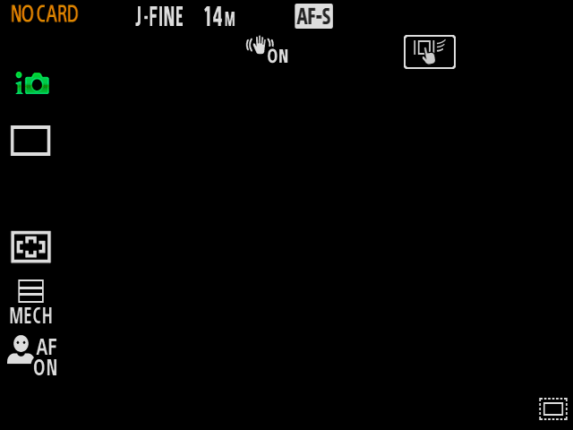
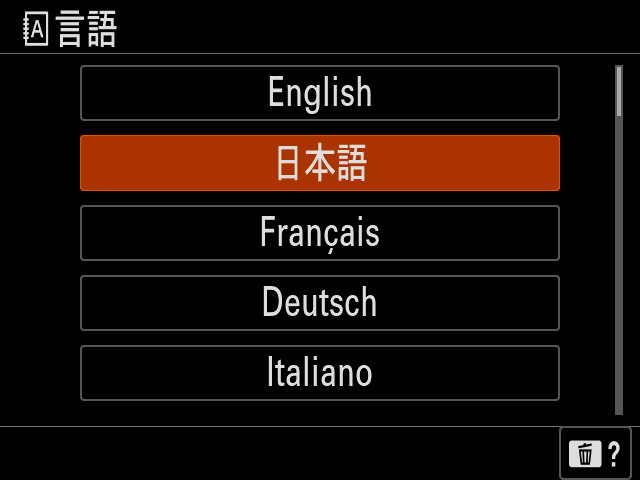

# A7M4 QEMU 运行时（ILCE-7M4 6.02）

在本机隔离 QEMU 中启动 Sony A7M4 原厂系统，加载原厂内核、模块和
`bootin.elf → im.elf`，用于继续研究原厂 UI/拍摄链。实现参考了本项目的
A7C2、FX30 和 ZV-E10 QEMU 运行时。

**当前状态（2026-11-04）：实验路径加入`--skip-setup`后，原启动流程可直接进入拍摄主界面，跳过语言/日期首设及触摸教学。
原bitmap已显示`NO CARD`、`J-FINE 14M`、`AF-S`和拍摄控件；21个原资源解压、110次GPE COPY、17次Flush通过。
帧消费者保存并读回实际像素后返回原完成，已观察到序号256。取景区域仍为黑色，CMOS、按键交互及拍照录像未验收。** 默认 `app` 保留可启动基线，实验复现见下方原线程报告。
这是一份可继续开发的移植基线，不是“A7M4 已完整模拟”的声明。

## 已实际验证

| 项 | 证据 |
| --- | --- |
| 官方包身份 | `model=0x1030081`、6.02、region 0、ALLLANG、crypter `CXD90057_k8` |
| 原内核 | `4.9.337-scel #1 SMP PREEMPT Sat Apr 18 02:42:38 JST 2026`，从 `/system/vmlinux.bin` 启动 |
| 根文件系统 | `nflasha7` ext2 + `nflasha15` ext2 `/usr`，`nflasha3` FAT `/system`，`nflasha8` FAT `/cp` |
| 原厂模块 | `devno`、`osal_utm/uipc`、`dma330`、`ldec`、`utimer`、`backup`、`ulogio`、`input`、`ioexp`、`indctr`、`udate`、`stream/stream2`、`dmm`、`icdt`、`kikilog`、`upm`、`grm_ma`、`mcmn_drv`、`codec_drv` 均 `rc=0` |
| 原厂应用 | `bootin.elf` → `im.elf`；stella HeapAllocator、`mpMemoryHeap`、`mpTextHeap` 日志出现；A7C2 observer 预载实验中 `Application_System_Init` 返回（实验日志未作为默认证据保留） |
| 原线程服务/显示 | 省略首设选项为原语言页；`--skip-setup`经原设置读回后自然进入拍摄UI。原资源、GPE像素及AP帧消费通过；十一条有限连接、CAPID/SA/DMM、原版本6.02及声效资源通过 |
| 稳定性 | 当前 35 秒窗口内无 kernel crash、无 guest abort/exception dump；应用保持运行并周期性重试 `0x86f` |
| 未完成 | 按键交互和原bitmap的QEMU窗口呈现；完整CP/PCIe、CMOS、镜头、AF、编码、拍照/录像、虚拟SD |

原厂拍摄主界面（原 OSD 图层合成到黑底的展示预览）：



原厂语言选择页：



目前保存的是以上两类界面，按 `MENU` 打开的设置菜单尚未完成交互验证和截图。拍摄预览的黑色区域是展示底色，CMOS取景仍未实现。

[原RGBA透明图](validation/evidence/2026-11-04-direct-shooting-ui.png)保留原像素和透明度，白色背景的查看器会把透明区域显示为白色；上面的黑底预览只改变展示底色。[跳过首设报告](report/2026-11-03-a7m4-qemu-bringup/2026-11-04-skip-first-setup.md)及历史控制台与摘要见 [`validation/evidence/`](validation/evidence/)。运行目录`runtime/analysis/menu-runs/`是本机私有产物，不入库。

## 复现

需要 Linux x86_64、Python 3.12+、`debugfs`、`cpio`、`clang`/`lld` 和
AArch64 交叉头文件（重建 QEMU 时还需要 GTK3/SDL2/pixman/glib/libseccomp 开发包）；
建议 32 GiB 以上内存。QEMU 11.1.2 源码与 dtc 的来源见
[SOURCES.md](SOURCES.md)；本仓库不提供 Sony 固件。

```bash
# 1. 放好自己的 ILCE-7M4 ALLLANG BODYDATA.DAT
./start.sh prepare --bodydata /path/to/BODYDATA.DAT
./start.sh status

# 2. 编译/复用板级 QEMU（runtime/sources/ 已有本机构建产物则可跳过）
./build-qemu.sh

# 3. 启动原厂应用；2 vCPU 是当前能进入 stella 的配置
./start.sh app --seconds 35

# 4. 只启动到 guest shell（1 vCPU，可交互）
./start.sh shell --command 'uname -a'
```

跳过首设直接查看原拍摄UI（实验路径）：

```bash
python3 runtime/analysis/experimental/run-ui-trace.py \
  --seed-power --hdmi-observer --updater-close --capid-storage \
  --sa-address --dmm-storage --firmware-identity --display-model \
  --skip-setup --seconds 50
```

该选项只在独立VM中经原Backup/日期API准备状态并读回，保留官方包语言；不改默认`app`基线。原bitmap的PNG保存在打印出的`EVIDENCE`目录。

`prepare` 只读 `BODYDATA.DAT`，在 `runtime/analysis/` 生成 `menu-root/` 与
`menu-root.cpio`；原始固件和只读分区不被修改。`app` 使用 `a7m4.run=1`
让 guest init 自动加载模块并启动原厂应用；2 vCPU 下 PL011 不能作为交互 shell，
这是现有板级模型的已知限制。

## 移植中确认的 A7M4 事实

以下地址均为 appFw 的 ELF VA，运行时加模块 load bias：

| 对象 | A7M4 6.02 | 对照 A7C2 |
| --- | --- | --- |
| 唯一具名导出 `Application_System_Init` | `0x183dbc0` | `0x1796918` |
| `view::create_screen` 实现 | `0x186a51c` | `0x17cdb00` |
| view 分发表 slot 0 | `0x584e0a8` | `0x58dbf38` |
| view 分发表基址（日志） | `0x584e098` | `0x58dbf28` |
| A7M4 `libgpe.so` | 与 A7C2 **字节相同**（SHA-256 `80fc6236…`） | 同 |

`view::create_screen` 的定位依据是 A7C2 同名函数的序言/常量模式
（`mov x8,#0x5e08`、`add x1,x25,#0x18c,lsl#12`、`add #0xe48`、屏幕数组循环），
并用 A7M4 的 `stp x29,x30,[sp,#-240]!`、`0x5e08`、`0xfa40` 等原指令核对。
分发表 slot 由 `.rela.dyn` 中 `0x584e0a8 -> 0x186a51c` 的 `R_AARCH64_RELATIVE`
确认。详细过程、否定实验和原始日志索引见[启动报告](report/2026-11-03-a7m4-qemu-bringup/README.md)。

## 当前阻塞

1. 实验路径的原 `AppFw` 线程已进入主消息循环，**自然调用并返回
   `view::create_screen(0x315)`**。原冷启动任务 `0x2b` 已完成；HDMI 注册、
   CAPID 表存储、SA 地址转换、CP DMM 双缓冲及原 UPM/版本查询均有实际消费证据。
2. 原boot已越过future等待并自然切到完整语言页`0x12e`。原LZ资源与GPE实际生成UI，
   AP consumer持原bitmap读租约读取实际像素、保存及读回后回复完成；原帧等待已解除。
   QMP原bitmap及自动导出PNG分别保存。`--skip-setup`现已让原控制器自然进入拍摄主界面；后续推进按键与成像，当前默认ramfb窗口仍需接入原bitmap呈现。
   详见[2026-11-04 原线程证据与判断更正](report/2026-11-03-a7m4-qemu-bringup/2026-11-04-original-ui-chain.md)。
   `0x9400e1` 是已有实例探测，首次启动失败不等于 boot 消息丢失；
   `0x80924127/0x920111` 是 UPM 开机信息，旧实验的“显示状态”标注已撤销。
3. `liro.ko` 缺 `pciatu_map/unmap`、PCIe/CP 尚未恢复，仍是明确的未实现项。
   它是否是当前初始化 future 的直接阻塞，需以实际工作线程栈和请求核验；
   不再仅凭直接调用 UI 函数未返回就归因 CP。

11-03历史否定实验见[启动报告 §7.4](report/2026-11-03-a7m4-qemu-bringup/README.md)：
电源/日期种子、`libIMDB` mask、imaging pipeline `0x92840747`、A7M4
`0x92b4086f` 发送侧 `0x2304/0x2300` 回复、`0x5503e0` 按键注入、最小 GPE 后端
和 `target/dmode` 变体都没有触发 `view::create_screen` 或 GPE 像素。可复用源码在
`runtime/analysis/experimental/`，默认 `app` 不加载它们。

已验收的是原UI显示与实际AP帧消费；完整按键交互、取景、拍照录像及CMOS继续分别验收。

## 边界与安全

- 仅本机隔离 QEMU；不连接真机、不直通真实 SD/物理磁盘、不刷固件。
- 原始 `BODYDATA.DAT`、解包目录和 Sony setting 不随包分发；`BODYDATA.DAT`
  与 `runtime/analysis/menu-root*` 均在 `.gitignore` 内。
- 当前没有 CMOS 帧、没有虚拟 SD 成片，也没有物理 ASIC 等价性结论。

## 目录

```text
final/a7m4-qemu/
├── start.sh                     # prepare/shell/app/status
├── build-qemu.sh                # 离线构建板级 QEMU
├── source/                      # QEMU 补丁、dtc、官方源码下载清单
│   ├── upstream/                # 40 个 Sony 6.00 源码包（本机，不入库）
│   └── SOURCE-SHA256SUMS
├── runtime/analysis/
│   ├── a7m4_import.py           # BODYDATA → rootfs/cpio
│   ├── a7m4_qemu.py             # DTB/内核/initrd 固定地址启动
│   ├── a7m4_session.py          # 原厂 initrc 模块顺序 + bootin
│   ├── a7m4_cli.py              # 命令行入口
│   ├── native_smp.py            # 双 CPU PSCI DTB
│   ├── qemu-virt-board/         # 固定地址 virt DTB
│   └── vendor/                  # fwtool SDK / PyCryptodomex
├── report/2026-11-03-a7m4-qemu-bringup/
├── validation/evidence/
└── docs/
```

第三方许可见 [THIRD-PARTY.md](THIRD-PARTY.md)，源码与下载见 [SOURCES.md](SOURCES.md)。
