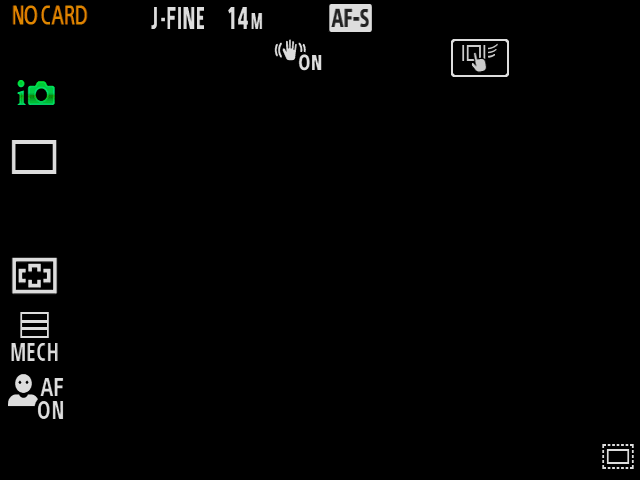

# A7M4 QEMU 运行证据

上图将原RGBA图层合成到不透明黑底，供GitHub等查看器展示；[原透明PNG](2026-11-04-direct-shooting-ui.png)和原bitmap摘要保留不变。透明图的中心像素为`RGBA=(0,0,0,0)`，查看器用白底时会显示为白色。黑底预览不代表已恢复CMOS图像。

现有截图覆盖原拍摄界面与语言选择页；`MENU`设置菜单尚无经验证截图。

最新[直接进入原拍摄UI原透明PNG](2026-11-04-direct-shooting-ui.png)和[验收摘要](2026-11-04-direct-shooting-ui.json)来自`ui-trace-20261104-163258`。`--skip-setup`经原API读回设置完成态及原时钟后，原屏`315→355→351→0`，语言/触摸教学页均未出现。截图为原bitmap字节转换，显示`NO CARD`、`J-FINE 14M`、`AF-S`与原拍摄控件；没有CMOS预览或成片验收。详情见[首设跳过报告](../../report/2026-11-03-a7m4-qemu-bringup/2026-11-04-skip-first-setup.md)。

2026-11-04 的[原厂语言页PNG](2026-11-04-original-language-ui.png)和[内容摘要](2026-11-04-original-language-ui.json)来自实验运行`ui-trace-20261104-160330`。原线程自然创建`0x315→0x12e`，7个原资源解压、72次GPE COPY和2次Flush均实际执行。PNG直接转换QMP读回的原bitmap，614400B、355155B非零；没有主机重绘语言文字或控件。

原AP帧消费者取得原bitmap引用/读锁并读取实际像素，保存、读回后才回复原完成消息；已观察到序号256，13条抽样日志不等于总共13帧。原厂语言页显示通过；交互按键、拍摄主界面、CMOS、镜头、编码、成片及物理ASIC兼容性未验收。复现命令见[实验说明](../../runtime/analysis/experimental/README.md)。默认`app`仍保留历史可启动基线。

下面这些11-03文件来自同一次默认运行
`runtime/analysis/menu-runs/app-20261103-184605/`（本机私有目录，不入库）：

| 文件 | 内容 |
| --- | --- |
| `2026-11-03-app-console.log.gz` | QEMU 串口完整控制台（gzip） |
| `2026-11-03-app-key-lines.txt` | 关键行摘录：内核版本、模块、FixedArea、liro、stella、UIPC |
| `2026-11-03-app-evidence.json` | 机器可读摘要；`create_screen=false` |
| `2026-11-03-no-display.png` | 同次 QMP `screendump`；ramfb 仍显示未初始化占位，不是原厂 UI |
| `SHA256SUMS` | 上述文件摘要 |

判据边界：该运行证明原厂内核、模块、`bootin.elf`/`im.elf` 和 stella/UI 引擎
已经实际执行；不证明 `view::create_screen`、拍摄页面、CMOS、镜头、编码或
成片。截图中的画面不是 Sony UI，不能作为“UI 已恢复”的证据。

复现：`./start.sh app --seconds 35`（2 vCPU，`a7m4.run=1`）。
